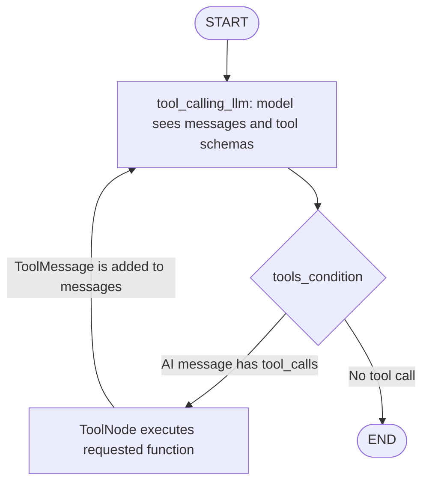

# LangGraph Tool Calling with Built-in Routing

This lesson fills in the graph-building concept shown in the attached example: using `MessagesState`, `ToolNode`, and the built-in `tools_condition` router to connect a tool-aware model to Python tools.

The runnable example is [toolCallingWithBuiltInRouting.py](toolCallingWithBuiltInRouting.py).

## What was easy to miss?

A tool-calling agent needs more than a tool function. The model must be given the tool's schema, the graph must detect when the model asks to call a tool, a node must execute that call, and the result must be sent back to the model. LangGraph's `MessagesState`, `ToolNode`, and `tools_condition` provide the pieces for this pattern.

## The complete execution pattern



A typical tool-use turn therefore looks like:

```text
HumanMessage
    ↓
AIMessage(tool_calls=[...])
    ↓
ToolMessage(result)
    ↓
AIMessage(final natural-language answer)
```

The graph can also take a direct path from the model node to `END` when no tool is needed.

## 1. `MessagesState`: ready-made message state

A custom message state is often written like this:

```python
class AgentState(TypedDict):
    messages: Annotated[list[BaseMessage], add_messages]
```

LangGraph provides `MessagesState` for this common shape. It already defines a `messages` field with the message-append/update reducer, so the example can use:

```python
builder = StateGraph(MessagesState)
```

Nodes return just their new messages:

```python
return {"messages": [response]}
```

LangGraph merges those updates into the existing conversation. The node should return an update rather than manually appending to the incoming state list.

## 2. `@tool` and `bind_tools()` have different jobs

The example defines a normal Python function and decorates it:

```python
@tool
def multiply(a: int, b: int) -> int:
    """Multiply two integers and return their product."""
    return a * b
```

The decorator turns the function into a tool with a name, description, and argument schema. The docstring and type hints help the model determine when to call it and what arguments to supply.

The list is then bound to the model:

```python
tools = [multiply]
llm_with_tools = llm.bind_tools(tools)
```

`bind_tools()` makes tool definitions available to the model. It does **not** run the Python function. The model produces a structured tool request in an `AIMessage`; the graph's tool node is responsible for executing it.

## 3. The model node

```python
def tool_calling_llm(state: MessagesState) -> dict:
    response = llm_with_tools.invoke(state["messages"])
    return {"messages": [response]}
```

This node sends the accumulated conversation to the tool-aware model. The response can be either:

- An ordinary assistant response, with no tool call; or
- An assistant message containing one or more structured `tool_calls`.

The model requests a tool; it does not directly invoke the local Python function.

## 4. `ToolNode`: execute requested tools

```python
tool_node = ToolNode(tools)
builder.add_node("tools", tool_node)
```

`ToolNode` reads tool calls from the latest assistant message, finds the corresponding registered tool, runs it with the requested arguments, and adds a `ToolMessage` containing the result to the graph's message state. Tool calls and results are associated so the model can tell which result belongs to which request.

Keep the same tool collection available to both `bind_tools()` and `ToolNode`. Binding only to the model can produce a request that no graph node knows how to execute; registering only with `ToolNode` does not tell the model that the tool exists.

## 5. `tools_condition`: built-in conditional routing

A hand-written router often inspects the final message itself:

```python
def should_continue(state):
    last_message = state["messages"][-1]
    if last_message.tool_calls:
        return "tools"
    return END
```

The prebuilt `tools_condition` performs that common decision. In this graph, it routes to `"tools"` when the last AI message contains tool calls; if not, it routes to `END`.

The example makes the route mapping explicit:

```python
builder.add_conditional_edges(
    "tool_calling_llm",
    tools_condition,
    {
        "tools": "tools",
        END: END,
    },
)
```

Here the router's `"tools"` result maps to the node named `"tools"`, while `END` means stop. If the router's route names match graph node names and the special end value, the mapping can often be omitted; including it here makes the branch destinations easy to see.

## 6. Why the edge returns from tools to the model

```python
builder.add_edge("tools", "tool_calling_llm")
```

Tool execution is not normally the end of the user-facing turn. The model needs to read the `ToolMessage` and turn the raw result into a useful answer. The next model invocation may itself request another tool, so the conditional branch is evaluated again. The loop ends when the model responds without requesting a tool.

The `"tool_calling_llm"` and `"tools"` strings are node names, not Python function names or tool names. The tool in this example is named `multiply`; its graph execution node is named `tools`.

## 7. Graph construction, in order

```python
builder = StateGraph(MessagesState)
builder.add_node("tool_calling_llm", tool_calling_llm)
builder.add_node("tools", ToolNode(tools))
builder.add_edge(START, "tool_calling_llm")
builder.add_conditional_edges("tool_calling_llm", tools_condition, ...)
builder.add_edge("tools", "tool_calling_llm")
graph = builder.compile()
```

1. `StateGraph(MessagesState)` chooses the state schema.
2. `add_node()` registers the model and tool-execution steps.
3. The `START` edge chooses the first node.
4. The conditional edge routes based on the model's latest message.
5. The tools-to-model edge creates the agent loop.
6. `compile()` validates the graph and creates the runnable graph.

## 8. Example state progression

For the request “What is 452 multiplied by 12?”, a successful tool call can produce a conversation like this:

1. **Input:** `HumanMessage("What is 452 multiplied by 12?")`
2. **Model request:** `AIMessage` with a `multiply` tool call and arguments such as `{"a": 452, "b": 12}`
3. **Router:** `tools_condition` sees that tool call and selects the `tools` node
4. **Execution:** `ToolNode` invokes `multiply(a=452, b=12)`
5. **Tool result:** a `ToolMessage` containing `5424` is added to the messages
6. **Second model call:** the model sees the question, tool request, and result
7. **Final answer:** an `AIMessage` explains that the product is 5,424; the router now selects `END`

The exact wording and whether a model chooses a tool can vary. The example asks it explicitly to use the tool to make the intended path clear.

## 9. Setup and running

The workspace already includes LangGraph, LangChain Groq, and dotenv dependencies in the root [requirements.txt](../requirements.txt). The example loads environment variables from `.env` and requires `GROQ_API_KEY` to be set there or in the process environment. Never commit a real API key.

Run the Python file from the workspace's configured environment. It makes a live request to Groq, so successful execution requires network access, a valid key, and a model that supports tool calling. The second sample question demonstrates the direct-to-`END` route; the model may still choose tools differently depending on its response.

## 10. Comparison with a custom router

The earlier [4htSimilarProgram,py](4htSimilarProgram%2Cpy) demonstrates the same basic agent/tool loop with a manually written router. This version replaces that custom check with `tools_condition` and replaces the hand-defined message state with `MessagesState`.

| Concern | Manual version | This version |
|---|---|---|
| Message state | Custom `TypedDict` with `add_messages` | Built-in `MessagesState` |
| Tool decision | Custom function checks `last_message.tool_calls` | Prebuilt `tools_condition` |
| Tool execution | `ToolNode(tools)` | `ToolNode(tools)` |
| Return after tools | Edge back to model | Edge back to model |

Use a custom router when the workflow needs extra conditions, such as approval, tool-specific branches, or state flags. Use `tools_condition` when the decision is simply “execute pending tool calls, otherwise finish.”

## 11. Common mistakes

- **Forgetting `bind_tools(tools)`:** The model has not been given tool schemas and may answer without requesting a tool.
- **Forgetting `ToolNode(tools)`:** The model may request a tool, but there is no graph node to execute it.
- **Using different tool lists:** A model could request a tool that the `ToolNode` does not know.
- **Skipping the tools-to-model edge:** The function runs, but the model never gets a chance to interpret its result.
- **Returning a plain string instead of a state update:** Nodes should return a dictionary such as `{"messages": [response]}`.
- **Assuming the LLM runs Python:** The LLM only emits a structured request; `ToolNode` runs the registered Python function.
- **Missing `GROQ_API_KEY`:** Set it in `.env` or the environment before running the example.

## Key takeaway

`MessagesState` holds the conversation, `bind_tools()` lets the model request tools, `tools_condition` decides whether to route to execution or finish, and `ToolNode` executes the registered Python function. The edge from `tools` back to the model completes the cycle:

```text
Model → tools_condition → ToolNode → Model → final answer
```
