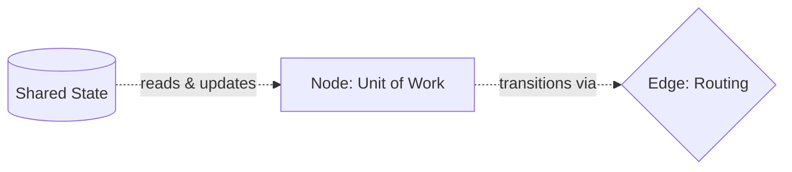
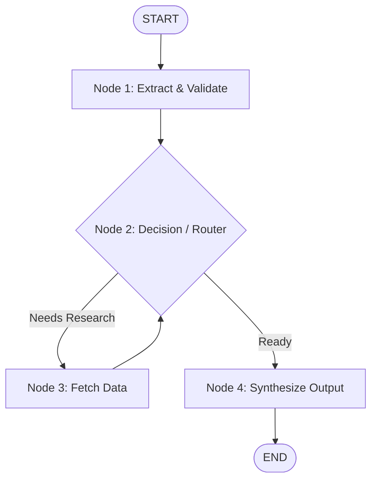

# LangGraph Fundamentals

LangGraph is a library designed for building robust, stateful, multi-actor applications with Large Language Models (LLMs). It extends the LangChain ecosystem by modeling agentic workflows as cyclical graphs.

---

## 1. Core Architecture at a Glance

The triad of LangGraph consists of **State**, **Nodes**, and **Edges**:

| Component | Responsibility | Description |
| :--- | :--- | :--- |
| **State** | **Data / Memory** | Carries the shared context across all execution steps. |
| **Nodes** | **Compute / Work** | Isolated functions or tools that receive the state and return updates. |
| **Edges** | **Routing / Control** | Determine which node executes next based on static rules or dynamic conditions. |



---

## 2. Key Concepts

### A. State: The Graph's Shared Memory
* **Definition:** A centralized data schema representing the current snapshot of your application.
* **Mechanism:** Every node receives a copy of the current state and returns a dictionary with updates to specific keys.
* **Implementation:** Typically defined using Python's `TypedDict` or Pydantic models.

```python
from typing import TypedDict, Annotated
import operator

class ProjectState(TypedDict):
    input: str
    intermediate_steps: Annotated[list[str], operator.add]
    final_output: str
```

---

### B. Special Control Points
* **`START`**: The designated entry point where graph execution begins.
* **`END`**: The terminal node. Reaching `END` halts graph execution and yields the final state.

---

### C. Nodes: Units of Execution
A node represents an individual computational step. A node can be:
- A pure Python function
- An LLM invocation
- A database or external API call
- A dedicated sub-agent or tool execution

```python
def retrieve_data_node(state: ProjectState) -> dict:
    query = state["input"]
    # Perform processing/retrieval
    return {"intermediate_steps": [f"Retrieved context for: {query}"]}
```

---

### D. Edges: Control Flow & Routing
Edges determine the progression path between nodes:

1. **Fixed (Normal) Edges:** Always transition unconditionally from Node A to Node B.
   ```mermaid
   flowchart LR
       NodeA[Node A] --> NodeB[Node B]
   ```

2. **Conditional Edges:** Dynamic branch points. A routing function inspects the current state and chooses the subsequent node.
   ```mermaid
   flowchart LR
       Router{Router Node}
       Router -->|Requires search| ToolNode[Tool Node]
       Router -->|Search complete| AgentNode[Agent Node]
   ```

---

## 3. End-to-End Execution Flow

A typical linear pipeline runs sequentially through nodes, but LangGraph also supports cycles and conditional loops:



---

## 4. Lifecycle & Compilation

A LangGraph workflow undergoes three key phases:

1. **Definition:** Instantiate `StateGraph(StateSchema)` and register nodes and edges.
2. **Compilation:** Call `.compile()`. This validates the graph structure and returns an executable runnable.
3. **Execution:**
   - `.invoke(initial_state)`: Runs the graph synchronously to completion and returns the final state.
   - `.stream(initial_state)`: Streams intermediate state changes or token emissions node-by-node.

---

## 5. Practical Capstone Template

Below is a complete, minimal implementation demonstrating how these pieces connect:

```python
from typing import TypedDict, Literal
from langgraph.graph import StateGraph, START, END

# 1. Define State
class CapstoneState(TypedDict):
    task: str
    analysis: str
    status: Literal["continue", "finish"]

# 2. Define Nodes
def analyzer_node(state: CapstoneState) -> dict:
    task = state["task"]
    # Simulated analysis step
    status = "finish" if len(task) > 10 else "continue"
    return {"analysis": f"Analyzed: {task}", "status": status}

def refiner_node(state: CapstoneState) -> dict:
    return {"task": state["task"] + " (expanded)"}

# 3. Define Conditional Routing Logic
def route_step(state: CapstoneState) -> str:
    if state["status"] == "finish":
        return "end_step"
    return "refine_step"

# 4. Build Graph
builder = StateGraph(CapstoneState)

builder.add_node("analyzer", analyzer_node)
builder.add_node("refiner", refiner_node)

builder.add_edge(START, "analyzer")
builder.add_conditional_edges(
    "analyzer",
    route_step,
    {
        "refine_step": "refiner",
        "end_step": END
    }
)
builder.add_edge("refiner", "analyzer")  # Creates a loop until condition is met

# 5. Compile & Execute
graph = builder.compile()

initial_input = {"task": "Build capstone", "analysis": "", "status": "continue"}
result = graph.invoke(initial_input)

print("Final Result:", result)
```

---

## 6. Quick Reference Checklist

- [ ] Does your state contain all necessary fields for node communication?
- [ ] Do node functions take `state` as an argument and return a `dict` with updates?
- [ ] Are entry (`START`) and terminal (`END`) edges properly declared?
- [ ] Did you invoke `.compile()` before calling `.invoke()` or `.stream()`?